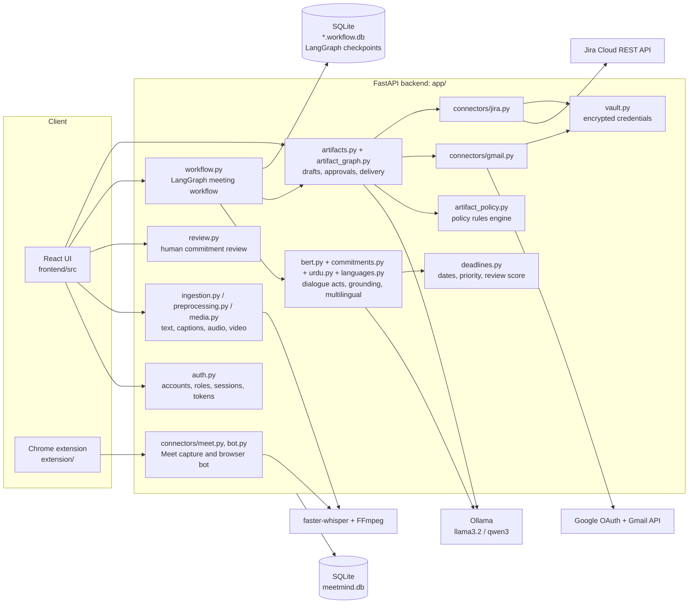
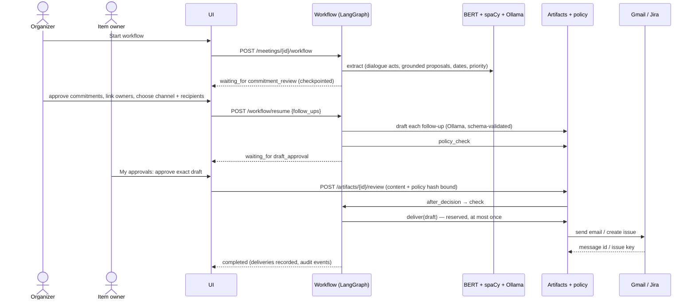
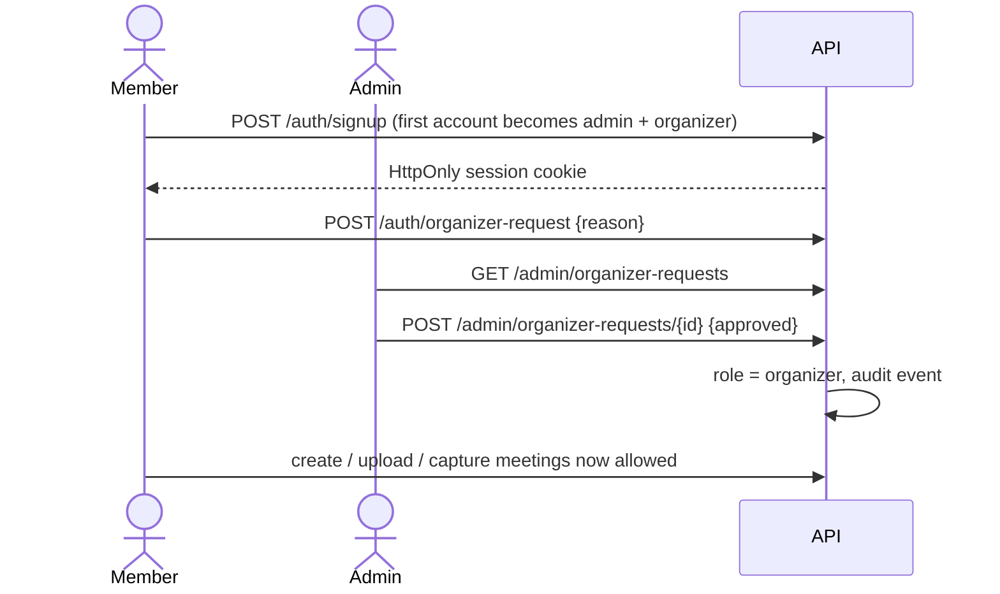
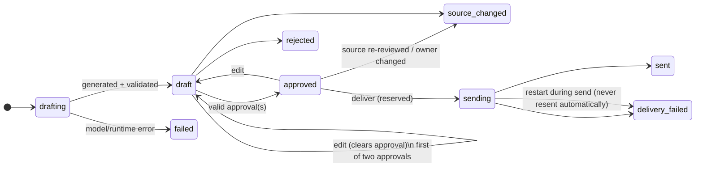
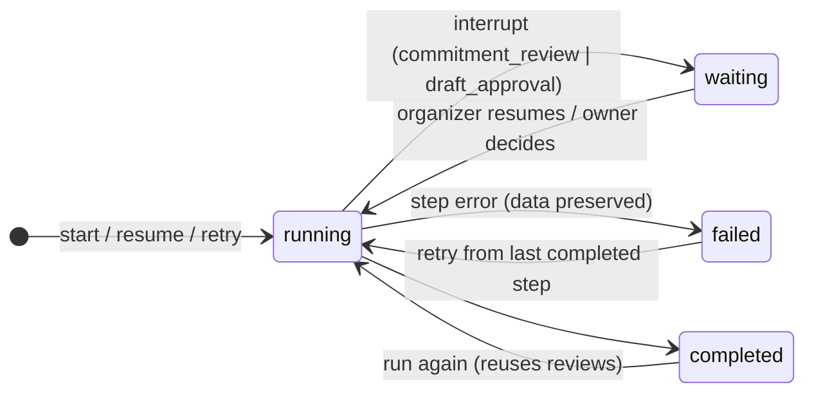
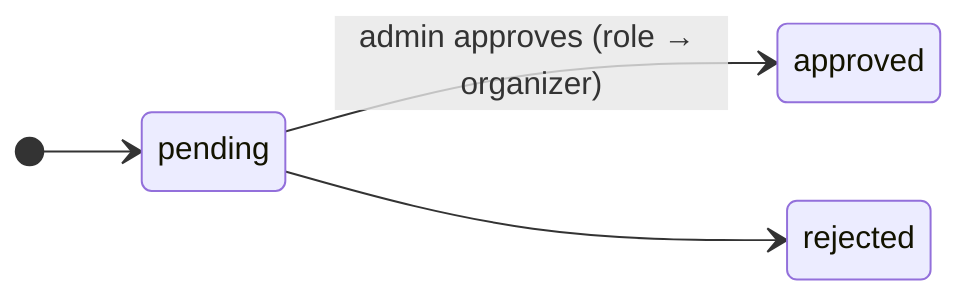

# MeetMind design: current implementation (Iterations 1–2)

Generated from the code on 14 Nov 2026 to update the Mid report's design chapter. Every element maps to a file named below. The diagrams use Mermaid, which renders on GitHub and in VS Code. Export them to images for the LaTeX report.

## 1. Components



## 2. Data model (ERD)

Meetings, artifacts, bots and workflows store a JSON `payload` (document style). The other tables are relational. SQLite does not enforce the logical links shown here; the code checks them.

```mermaid
erDiagram
  users ||--o{ sessions : "signs in"
  users ||--o{ api_tokens : "capture tokens"
  users ||--o{ role_requests : "requests organizer"
  users ||--o{ meeting_members : "organizer / viewer"
  users ||--o{ assignments : "owns items"
  users ||--o{ integrations : "Gmail account"
  users ||--o| jira_users : "Jira account"
  users ||--o{ audit_log : "acts"
  meetings ||--o{ meeting_members : has
  meetings ||--o{ assignments : "item owners"
  meetings ||--o{ artifacts : "follow-up drafts"
  meetings ||--o| workflows : "workflow status"
  ingestion_jobs }o--|| users : "created by"
  ingestion_jobs }o--o| meetings : produces
  meeting_bots }o--|| users : "started by"
  users { text id PK; text email UK; text name; text password_hash; text role "member|organizer"; int is_admin; int active }
  sessions { text token_hash PK; text user_id FK; text expires_at }
  api_tokens { text id PK; text user_id FK; text token_hash UK; text scope "capture"; text expires_at; int revoked }
  role_requests { text id PK; text user_id FK; text reason; text status "pending|approved|rejected"; text decided_by }
  meeting_members { text meeting_id PK; text user_id PK; text role "organizer|viewer" }
  assignments { text meeting_id PK; text item_id PK; text user_id FK; text assigned_by }
  meetings { text id PK; json payload "segments, actions, candidates, review history, BERT analysis" }
  artifacts { text id PK; text meeting_id FK; text request_key UK; json payload "channel, to, subject, body, source snapshot, approval(s), delivery, history" }
  workflows { text meeting_id PK; json payload "run, stage, waiting_for, drafts, deliveries, history" }
  ingestion_jobs { text id PK; text status; int progress; text meeting_id; text user_id }
  meeting_bots { text id PK; json payload }
  integrations { text user_id PK; text provider PK "gmail|jira"; text account; text secret "encrypted" }
  oauth_states { text state PK; text user_id; text verifier; text expires_at }
  jira_users { text user_id PK; text account_id; text display_name }
  audit_log { text id PK; text at; text actor_id; text action; text target; json detail }
  settings { text key PK; json value }
```

## 3. Main sequence: from meeting to executed follow-up



## 4. Sign-in and organizer request



## 5. State machines

```mermaid
stateDiagram-v2
  direction LR
  state "Commitment item" as C {
    [*] --> proposed
    proposed --> pending: edit (review)
    proposed --> approved
    proposed --> rejected
    pending --> approved
    pending --> rejected
    approved --> pending: re-review (invalidates drafts)
    note right of proposed: suggestion/request need explicit approval;\ncancellation can never be approved
  }
```









## 6. Requirements and traceability

| ID | Requirement | Code | Verified by |
|---|---|---|---|
| FR-01 | Ingest pasted text, TXT/MD/DOCX/VTT/SRT, audio and video with size limits and clear errors | `ingestion.py`, `preprocessing.py`, `media.py` | `test_ingestion.py`, `test_preprocessing.py`, `test_media.py`, `smoke-ui.cjs` |
| FR-02 | Capture Google Meet via extension (token-authenticated) or browser bot | `connectors/meet.py`, `bot.py`, `extension/` | `test_meet_sessions.py`, `test_bot.py`, `smoke-bot-ui.cjs` |
| FR-03 | Classify dialogue acts with fine-tuned BERT; flag low score, close alternatives and truncation | `bert.py` | `test_bert.py`, `reports/bert-base-test-v1` |
| FR-04 | Extract commitments, suggestions, requests and cancellations with exact source evidence | `commitments.py` | `test_commitments.py`, `test_audit_fixes.py` |
| FR-05 | Resolve owners and deadlines without guessing; normalise dates; detect priority | `commitments.py`, `deadlines.py` | `test_deadlines.py`, `test_audit_fixes.py` |
| FR-06 | Support English, Urdu and Roman Urdu input with original-text evidence | `languages.py`, `urdu.py` | `test_languages.py`, `smoke-languages-ui.cjs` |
| FR-07 | Human review: edit, approve or reject, with history, revision checks and persistence | `review.py`, `main.py` | `test_review.py`, `smoke-review-ui.cjs` |
| FR-08 | Accounts and roles (Admin, Organizer, Member, Owner) on every route | `auth.py` | `test_auth.py` (route walk), `smoke-roles-ui.cjs` |
| FR-09 | LangGraph meeting workflow with human pauses, restart persistence and retry | `workflow.py` | `test_workflow.py`, `smoke-workflow-ui.cjs` |
| FR-10 | Draft follow-up emails and Jira tickets; recipients and assignees chosen by people | `artifacts.py`, `artifact_graph.py` | `test_artifacts.py`, `test_jira.py` |
| FR-11 | Approval bound to exact content and policy; owner decides; optional second approver | `artifacts.py`, `artifact_policy.py` | `test_policy.py`, `test_auth.py` |
| FR-12 | Execute approved drafts at most once via Gmail and Jira, with delivery state | `connectors/gmail.py`, `connectors/jira.py`, `artifacts.deliver` | `test_gmail.py`, `test_jira.py`, `test_workflow.py` |
| FR-13 | Audit trail of sign-ins, roles, overrides, connections and deliveries | `auth.audit`, artifact history | `test_auth.py`, `test_gmail.py` |
| NFR-01 | Local-first: no hosted model APIs; Ollama and Whisper run locally | `commitments.py`, `media.py` | README setup |
| NFR-02 | Model outputs are hints, never authority: no auto-approval and no model-chosen recipients | `workflow.py`, `artifacts.py` | `test_workflow.py`, `test_artifacts.py` |
| NFR-03 | Failures keep existing data; restarts recover jobs, drafts, sends and workflows honestly | `main.lifespan`, `recover()` methods | `test_media.py`, `test_gmail.py`, `test_workflow.py` |
| NFR-04 | Credentials hashed or encrypted; secrets never returned by the API | `auth.py`, `vault.py` | `test_auth.py`, `test_gmail.py`, `test_jira.py` |
| NFR-05 | Reproducible evaluation with hashes, seeds and a frozen test split used once | `scripts/evaluate_bert.py`, `calibrate_bert.py` | `reports/bert-base-test-v1`, `reports/bert-base-calibration-v1` |
| NFR-06 | Responsive UI down to 390 px width | `frontend/src/styles.css` | mobile checks in all browser smoke scripts |

## 7. Differences from the proposal (needs mentor sign-off)

| Proposal | Implementation | Reason / impact |
|---|---|---|
| Anthropic Claude API | Local Ollama (llama3.2, qwen3) | Local-first privacy and no API cost; quality depends on the local model |
| OpenAI Whisper | faster-whisper (same Whisper models, run locally) | Faster on CPU, offline |
| Zoom / Teams live feeds | Google Meet extension and browser bot | Free accounts and no vendor approval needed; Zoom/Teams deferred |
| Six independent agents | One LangGraph workflow with specialised nodes (extract, draft, policy, execute) | Simpler to make safe and testable; nodes map to the proposed roles |
| PostgreSQL, Neo4j, ChromaDB, Docker | SQLite (document plus relational tables) | Single-user local demo; migration planned for Iteration 3 |
| Tailwind CSS | Plain CSS | No functional impact |
| Out of scope: real-time translation | Post-meeting Urdu/Roman Urdu translation for analysis | Added for local users; not real-time |
